 

<a href="https://pestping.com"><b>pestping.com</b></a> &nbsp;·&nbsp;
<b>Lahore, PK — UTC+5</b>

  

 

  

Client source code is kept private. Every panel on this page is custom-made SVG — no templates, no third-party widgets.

